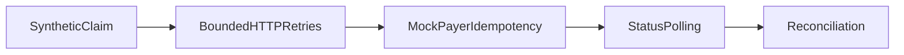

1. Mock payer API integration with retries, idempotency and reconciliation of claims status.

2. Result:
   Synthetic claims reconciled: 120  
   Injected payer timeouts: 35  
   Reconciliation discrepancies: 0  

   Measured with `make bench`: [raw results](evidence/bench.json), [command output](evidence/checks.log), [environment](evidence/environment.json).

3. Architecture:


4. Run it:
```sh
make setup
make lint test bench
make demo
```

5. Decisions and limits: Synthetic eligibility/claim data only. A real FastAPI mock and HTTP client ASGI transport exercise request parsing, idempotency conflicts and polling. Chaos injects both pre-response timeouts and ambiguous POST timeouts after the payer commits. No real payer, billing, PHI, insurance decision or clinical workflow is used. In-memory stores demonstrate the protocol; persistence, authentication and cross-process durability are not covered. evidence/reconciliation.json includes terminal statuses, pending-before count and discrepancies. Eligibility is a declared deterministic fixture rule, not a benefits determination.

6. Next: Persist request/receipt state and add reconciliation of partial outages across multiple mock payers.
